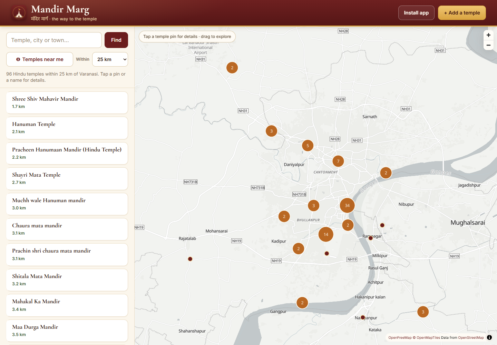
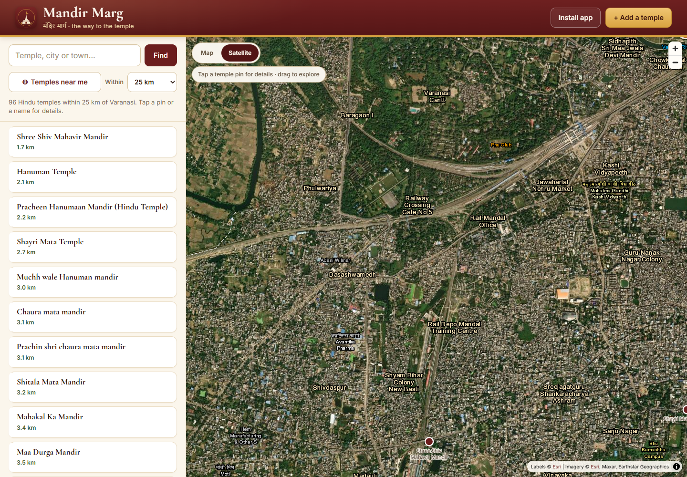

# Mandir Marg · मंदिर मार्ग

**A free, always-online, community-maintained map of Hindu temples.**

Mandir Marg ("the way to the temple") helps devotees find Hindu temples near them, learn a little
about each one, and add temples that are missing. It is a plain static website: no build step, no
framework, no server of your own to maintain. Everything runs on free tiers.

- **Live map** of Hindu temples from OpenStreetMap, clustered and searchable
- **Street or satellite view** — switch to Esri imagery to spot a temple roof, then tap the map to place its pin exactly
- **Find temples near me** using the browser's location, or search any city or town
- **Suggest a temple or an edit** from a phone-friendly form
- **Installable PWA** — add it to your home screen; the app shell works offline
- **Donations stay official** — v1 only shows a temple's own website/phone; it never handles money



Switch to **Satellite** to recognise a temple roof, then tap the map to drop its pin precisely.



---

## 1. Run it on your computer (2 minutes)

You need Python 3 (already on most computers). In this folder, either:

**Windows** — double-click `start.bat`.

**macOS / Linux**

```bash
cd mandir-marg
python3 tools/dev_server.py
```

Your browser opens <http://127.0.0.1:5173/>. Keep the terminal window open while you browse; press
`Ctrl+C` to stop.

The local server also emulates the production temple proxy at `/api/temples`, so you see exactly
what visitors will see.

> A plain double-click on `index.html` will not work well: browsers block map tiles and data
> requests from `file://` pages. Always use the local server.

---

## 2. Put it online for free (Cloudflare Pages)

Cloudflare Pages gives you a free `https://your-name.pages.dev` address, free HTTPS, and free
serverless functions — which this project uses for its cached temple proxy.

**Why Git instead of drag-and-drop?** Cloudflare's drag-and-drop upload does not include the
`functions/` folder. Connecting a Git repository does.

1. Create a free GitHub account and a new **empty** repository, for example `mandir-marg`.
2. Upload or push this `mandir-marg` folder to it. With Git:

   ```bash
   cd mandir-marg
   git init
   git add .
   git commit -m "Mandir Marg v1"
   git branch -M main
   git remote add origin https://github.com/YOUR-NAME/mandir-marg.git
   git push -u origin main
   ```

3. Go to <https://dash.cloudflare.com/> → **Workers & Pages** → **Create** → **Pages** →
   **Connect to Git** and pick the repository.
4. Build settings:
   - **Framework preset:** None
   - **Build command:** leave empty
   - **Build output directory:** `/` (the repository root)
5. Click **Save and Deploy**. In a minute your site is live at
   `https://your-project.pages.dev`.

### Custom domain (optional)

Pages → your project → **Custom domains**. You can keep the free `*.pages.dev` address forever, or
attach a domain you already own (about ₹500–1,200/year). Nothing else needs to change.

### What the free tier includes

- Unlimited static requests and unlimited bandwidth for this kind of site
- 100,000 Function requests per day (the proxy usually serves from cache, so this is plenty)
- Automatic HTTPS, HTTP/3 and a global CDN
- Rollbacks and preview deployments on every Git push

### Other free hosts

GitHub Pages, Netlify and Vercel all host the static site for free. On those hosts the
`functions/api/temples.js` endpoint is not deployed, so the browser calls Overpass directly and
relies on its local 6-hour cache. That works, but public Overpass servers are rate-limited. For a
reliable public site, Cloudflare Pages is recommended.

---

## 3. Collect contributions from everyone (optional, free)

Out of the box, suggestions are saved in the visitor's browser (`localStorage`) so you can try the
flow. To collect them centrally:

1. Create a free project at <https://supabase.com/>.
2. Open **SQL Editor**, paste the contents of [`supabase/schema.sql`](supabase/schema.sql), run it.
   This creates `temple_suggestions` with insert-only Row Level Security.
3. Open **Project Settings → API** and copy:
   - **Project URL**
   - **anon public** key
4. Put both into [`js/config.js`](js/config.js):

   ```js
   window.MANDIR_MARG_CONFIG = {
     supabaseUrl: "https://abcdefgh.supabase.co",
     supabaseAnonKey: "eyJhbGciOi..."
   };
   ```

5. Commit and push. New suggestions now arrive in **Table Editor → temple_suggestions** with
   `status = pending`.

The anon key is designed to be public. The policy allows **inserts only**, so nobody can read,
change, approve or delete other people's suggestions with it. Review suggestions in the Supabase
dashboard, then add good ones to the map (see the roadmap for a planned admin screen).

Suggested review rule: approve only information you can verify from an official temple source, and
remove personal phone numbers submitted without consent.

---

## 4. Where the temple data comes from

Temple locations come from **OpenStreetMap**, queried through the [Overpass API](https://overpass-api.de/).

Request flow:

```
browser ──▶ /api/temples (Cloudflare Function, cached 30 min at the edge)
              └─▶ Overpass mirror 1 … 4 (server-side failover)
browser ──▶ Overpass directly (only when the proxy is not deployed)
```

The browser also caches each searched area for **6 hours** in `localStorage`, so revisiting a city
is instant and does not touch the network. The proxy rounds coordinates to two decimals, which
means everyone in the same district shares one upstream request.

Only elements named in OSM are listed. Each card shows the local name, distance, deity or tradition
when tagged, and links to directions, the OSM object and the temple's own website.

**Please be a good citizen of the Overpass service.** The proxy exists to reduce load, caches
responses, and sends an identifying User-Agent. Do not remove the cache or raise the query limits
without a reason. If Mandir Marg grows large, the next step is a scheduled import into Supabase
rather than more live queries.

### Attribution and licences

- Temple data © [OpenStreetMap contributors](https://www.openstreetmap.org/copyright), available
  under the [Open Database License (ODbL)](https://opendatacommons.org/licenses/odbl/). The
  attribution is shown in the app and must stay visible.
- Basemap tiles and style by [OpenFreeMap](https://openfreemap.org/), using OpenStreetMap data.
  The raster fallback uses `tile.openstreetmap.org`.
- Satellite imagery and its labels by [Esri](https://www.esri.com/) (World Imagery: Esri, Maxar,
  Earthstar Geographics; World Boundaries and Places). The in-map attribution must stay visible.
- Place search by [Photon](https://photon.komoot.io/) (Komoot), based on OpenStreetMap.
- Map rendering by [MapLibre GL JS](https://maplibre.org/) (BSD-3-Clause).
- The app's own code and artwork: use them freely for dharmic, non-commercial work.

If you later add temple descriptions from Wikipedia, credit them and follow CC BY-SA.

---

## 5. Donations and money

Version 1 deliberately **does not accept, hold or route money**. A temple's official UPI ID, bank
details or website may be typed into the notes field or linked from the temple's own website, but
Mandir Marg never collects funds and cannot verify an account. Visitors should always confirm
donation details on the temple's official site or at the temple counter.

This keeps the project simple, avoids payment compliance, and protects devotees from fake
"donation" links. If a payments feature is ever added, it needs a registered entity, KYC, refund
handling and a verified-temple process — treat that as a separate, deliberate project.

**Keeping the site free.** Hosting, map tiles and geocoding are all on free tiers, so the only
possible cost is a custom domain. Reasonable future support, always disclosed:

- voluntary contributions to the maintainers (not to temples)
- services for temple trusts: verified listings, event pages, QR signage
- clearly labelled sponsorships from dharmic publishers or travel services
- affiliate links for pilgrimage travel, only where relevant

Never sell contributor data or visitor location data. There is no advertising or tracking in v1.

---

## 6. Project layout

```
mandir-marg/
├─ index.html                 Page structure, search, map, list, contribution dialog
├─ css/styles.css             All styling (cream/maroon/gold, responsive, reduced motion)
├─ js/config.js               Supabase URL + anon key (empty by default)
├─ js/app.js                  Map, Overpass/proxy loading, search, geolocation, form, PWA
├─ manifest.webmanifest       Installable app metadata
├─ sw.js                      Service worker: app shell offline, 6-hour data cache
├─ icons/                     SVG + PNG app icons and social preview image
├─ functions/api/temples.js   Cloudflare Pages Function: cached, validated Overpass proxy
├─ supabase/schema.sql        `temple_suggestions` table with insert-only RLS
├─ tools/dev_server.py        Local server + proxy emulator (no dependencies)
├─ tools/make-icons.py        Regenerates the PNG icons with Pillow
├─ _headers                   Security headers for Cloudflare Pages
└─ start.bat                  One-click local preview on Windows
```

### How the pieces fit

1. `app.js` reads the saved view (or defaults to Varanasi), shows the map, and asks
   `/api/temples` for temples.
2. The Function validates `lat`, `lng` and `radius`, checks Cloudflare's edge cache, otherwise
   tries four Overpass mirrors in order and caches the result for 30 minutes.
3. `app.js` turns OSM elements into temple records, sorts by distance, draws clustered pins and
   fills the list. Search filters locally first; if nothing matches, Photon geocodes the place and
   the map moves there.
4. "Pick the exact spot" closes the form, switches to satellite imagery, zooms to rooftop scale and
   takes the tapped coordinate, then reopens the form with the pin placed.
5. Suggestions go to Supabase when configured, and always stay in `localStorage` as a local copy.

### Changing the amount of data

- Radius options: `#radius` in `index.html` and `ALLOWED_RADII` in `functions/api/temples.js`.
- Result cap: `out center 300;` in `js/app.js` and `functions/api/temples.js` (keep both in sync).
- Default view: `DEFAULT_VIEW` in `js/app.js`.

---

## 7. Testing and maintenance

There is no build step, so there is nothing to compile. Before publishing a change:

1. Run `python tools/dev_server.py`.
2. Search a city, click a pin, add a temple, and reload to confirm the local suggestion persists.
3. Switch to **Satellite**, then Add a temple → **Pick the exact spot on the map** and tap a roof.
4. Check the browser console for errors.
5. Use `python tools/make-icons.py` after editing `icons/icon.svg` (needs `pip install pillow`).

Cache busting: bump `VERSION` in `sw.js` whenever you change the app shell, so installed copies
update. The service worker never caches `/api/` responses, which keeps temple data fresh.

---

## 8. Roadmap

**Next**

- Moderation screen for `temple_suggestions` (approve → promote into the map)
- Import approved temples into a `temples` table, merged with OSM at query time
- Hindi interface and temple names in Devanagari throughout
- Temple detail pages with timings, festivals, history and photos (with permission)

**Later**

- Android app with MapLibre Native, reusing the same Supabase tables and `/api/temples`
- Offline packs for major pilgrimage cities
- Verified temple accounts for official timings and donation details
- Accessibility and performance audits on low-end phones and slow networks

---

## 9. Credits

Built with seva for devotees everywhere. May it help people find their way to the temple.

If you spot a wrong temple, the best fix is often to correct it in OpenStreetMap itself — then
every map, not just this one, becomes more accurate.
